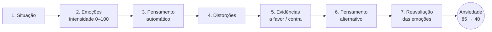
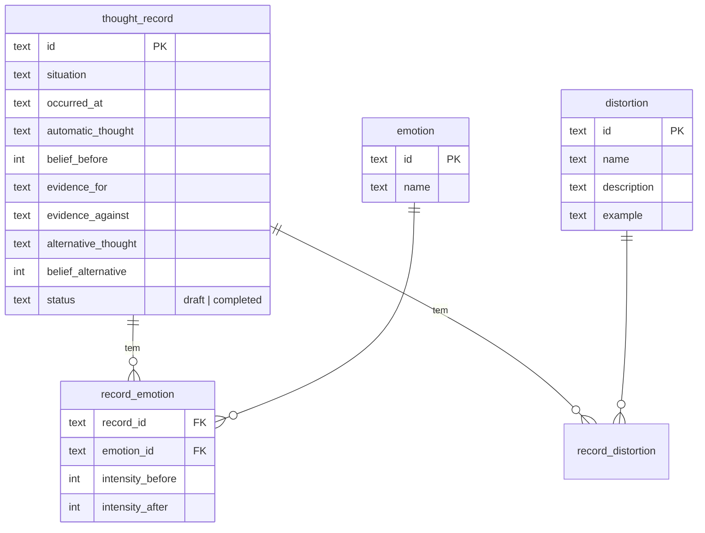

<div align="center">

# 🧠 Repensar

**Diário de pensamentos baseado na Terapia Cognitivo-Comportamental (TCC)**

Registre situações difíceis, identifique distorções cognitivas e acompanhe como suas emoções mudam quando você reestrutura o pensamento.

[](https://github.com/kinnitchi/repensar/actions/workflows/ci.yml)


</div>

> [!IMPORTANT]
> O Repensar é uma ferramenta de apoio e **não substitui acompanhamento psicológico ou psiquiátrico**.
> Se você estiver em sofrimento intenso, ligue para o **CVV (188)**, disponível 24h, ou para o **SAMU (192)**.

---

## 📋 Sumário

- [🧠 Repensar](#-repensar)
  - [📋 Sumário](#-sumário)
  - [💡 Sobre](#-sobre)
  - [✨ Funcionalidades](#-funcionalidades)
  - [📱 Screenshots](#-screenshots)
  - [🔄 Como funciona o registro](#-como-funciona-o-registro)
  - [🛠 Stack](#-stack)
  - [🏗 Arquitetura](#-arquitetura)
    - [Modelo de dados](#modelo-de-dados)
  - [🔒 Privacidade e segurança](#-privacidade-e-segurança)
  - [🚀 Como rodar](#-como-rodar)
    - [Scripts](#scripts)
  - [✅ Testes e qualidade](#-testes-e-qualidade)
  - [🗺 Roadmap](#-roadmap)
  - [📚 Base científica](#-base-científica)
  - [📄 Licença](#-licença)

## 💡 Sobre

O **Registro de Pensamentos Disfuncionais (RPD)** é uma das ferramentas mais usadas na TCC. A ideia central é que o que sentimos depende muito de como interpretamos as situações. Ao registrar o pensamento automático, reconhecer distorções e buscar evidências, a pessoa constrói uma visão mais equilibrada, e a intensidade da emoção costuma diminuir.

No papel, o RPD é trabalhoso de manter e difícil de analisar. O Repensar digitaliza o processo e mostra **padrões ao longo do tempo**: quais distorções aparecem mais, em que horários e quanto cada emoção diminui depois da reestruturação.

## ✨ Funcionalidades

**MVP**

- [x] Banco local criptografado (SQLCipher) com migrations versionadas
- [x] Catálogo de 12 distorções cognitivas e 8 emoções
- [x] Lista de registros com destaque de rascunhos e do resultado "85 → 40"
- [x] Detalhe e exclusão de registro
- [x] Insights: distorções mais frequentes e redução média por emoção
- [x] Conteúdo de psicoeducação
- [x] Exportar todos os dados (JSON) e apagar tudo (LGPD)
- [x] Botão de ajuda sempre visível (CVV 188 / SAMU 192)
- [ ] Wizard de registro em 7 passos com rascunho
- [ ] Gráficos de evolução semanal e mapa de calor
- [ ] Onboarding com consentimento e bloqueio por biometria/PIN
- [ ] Exportação em PDF para levar à sessão de terapia
- [ ] Lembrete diário

## 📱 Screenshots

| Registros  | Novo registro |  Insights  |  Aprender  |
| :--------: | :-----------: | :--------: | :--------: |
| _em breve_ |  _em breve_   | _em breve_ | _em breve_ |

<!-- Coloque os prints em docs/screenshots/ e um GIF do fluxo completo aqui. -->

## 🔄 Como funciona o registro



Os passos 1 e 2 já formam um **rascunho**: dá pra registrar na hora e concluir depois, com mais calma.

## 🛠 Stack

| Camada    | Tecnologia                                                                |
| --------- | ------------------------------------------------------------------------- |
| App       | React Native 0.88 + Expo SDK 58 + TypeScript (strict)                     |
| Navegação | Expo Router (rotas por arquivo)                                           |
| Banco     | expo-sqlite com SQLCipher                                                 |
| Segurança | expo-secure-store (chave no Keychain/Keystore), expo-local-authentication |
| Validação | Zod                                                                       |
| Testes    | Jest (jest-expo) + React Native Testing Library                           |
| Qualidade | ESLint, Prettier, GitHub Actions                                          |

## 🏗 Arquitetura

```
src/
├── app/                      # Telas (Expo Router)
│   ├── _layout.tsx           # SQLiteProvider + navegação raiz
│   ├── (tabs)/               # Registros, Insights, Aprender, Ajustes
│   ├── onboarding.tsx
│   └── record/               # new.tsx (wizard) e [id].tsx (detalhe)
├── db/
│   ├── database.ts           # Abertura, chave SQLCipher e PRAGMAs
│   ├── migrations.ts         # Migrations versionadas via PRAGMA user_version
│   └── seeds/                # Distorções e emoções
├── features/
│   ├── records/              # Tipos, schemas (Zod) e repositório (SQL)
│   ├── insights/             # Cálculos puros (sem banco, 100% testáveis)
│   └── security/             # Geração e armazenamento da chave do banco
├── components/
├── constants/                # Contatos de crise e avisos
└── theme/
__tests__/                    # Testes unitários
```

**Decisões principais**

- **Local-first:** nenhum servidor no MVP. Menos superfície de ataque e nenhum dado de saúde trafegando.
- **Regras de negócio em funções puras:** `features/insights` não conhece banco nem UI, então é testado direto com Jest, sem emulador.
- **Repositório isolado:** as telas não escrevem SQL. Trocar o armazenamento no futuro (ex.: sincronização) afeta só `repository.ts`.
- **Transações:** salvar um registro mexe em três tabelas, então tudo acontece numa transação exclusiva.

### Modelo de dados



## 🔒 Privacidade e segurança

Registros de pensamentos e emoções são **dados pessoais sensíveis de saúde** (LGPD, art. 11). O app foi desenhado em torno disso:

| Medida                  | Implementação                                                                      |
| ----------------------- | ---------------------------------------------------------------------------------- |
| Dados só no aparelho    | Sem backend, sem analytics, sem envio de dados                                     |
| Criptografia em repouso | SQLCipher com chave aleatória de 256 bits                                          |
| Proteção da chave       | Keychain (iOS) / Keystore (Android), acessível só com o aparelho desbloqueado      |
| Sem backup automático   | `allowBackup: false` no Android                                                    |
| Portabilidade           | Exportação completa em JSON                                                        |
| Eliminação              | "Apagar todos os dados" em Ajustes                                                 |
| Falha segura            | Em produção, o app se recusa a abrir o banco se o SQLCipher não estiver disponível |

## 🚀 Como rodar

**Pré-requisitos:** Node.js 22+ e um emulador Android/iOS ou aparelho físico.

```bash
git clone https://github.com/kinnitchi/repensar.git
cd repensar
npm install
```

O SQLCipher é um módulo nativo e **não roda no Expo Go**, então use um development build:

```bash
npx expo run:android   # ou: npx expo run:ios (macOS)
```

Ou gere o build na nuvem com EAS, sem precisar de Android Studio/Xcode:

```bash
npx eas-cli@latest build --profile development --platform android
```

> Pra testar rápido a interface no Expo Go (`npx expo start`), o app roda **sem criptografia** e mostra um aviso no console. Esse modo só existe em desenvolvimento.

### Scripts

| Comando                 | O que faz                            |
| ----------------------- | ------------------------------------ |
| `npm start`             | Inicia o servidor de desenvolvimento |
| `npm test`              | Roda os testes                       |
| `npm run test:coverage` | Testes com relatório de cobertura    |
| `npm run lint`          | ESLint                               |
| `npm run typecheck`     | Checagem de tipos do TypeScript      |
| `npm run format`        | Formata o código com Prettier        |

## ✅ Testes e qualidade

```bash
npm test
```

- Cálculos de insights (frequência de distorções, redução de intensidade, agrupamento semanal, mapa de calor)
- Validação dos dados do registro (rascunho e registro completo)
- Integridade dos seeds

A cada push e pull request, o GitHub Actions roda formatação, lint, typecheck e testes.

## 🗺 Roadmap

| Etapa | Entrega                                         | Status |
| ----- | ----------------------------------------------- | :----: |
| 1     | Setup, banco criptografado, migrations e seeds  |   ✅    |
| 2     | Wizard de 7 passos com rascunho e validação     |   ⏳    |
| 3     | Edição e duplicação de registros                |   ⏳    |
| 4     | Gráficos: evolução semanal e mapa de calor      |   ⏳    |
| 5     | Onboarding, biometria/PIN, PDF, lembrete diário |   ⏳    |
| 6     | Acessibilidade, modo escuro, APK em Releases    |   ⏳    |

**Depois do MVP**

- Backup opcional na nuvem com criptografia ponta a ponta
- Compartilhamento de registros específicos com o terapeuta
- Sugestão de distorções com IA, sempre como sugestão e com confirmação do usuário

## 📚 Base científica

As técnicas e o catálogo de distorções seguem a literatura clássica da TCC:

- BECK, Judith S. _Terapia Cognitivo-Comportamental: Teoria e Prática_. Artmed.
- BECK, Aaron T. _Cognitive Therapy and the Emotional Disorders_. International Universities Press, 1976.
- BURNS, David D. _Feeling Good: The New Mood Therapy_. William Morrow, 1980.
- GREENBERGER, Dennis; PADESKY, Christine A. _A Mente Vencendo o Humor_. Artmed.

O conteúdo do app tem caráter psicoeducativo. Ele não faz diagnóstico e não substitui avaliação profissional.

## 📄 Licença

Distribuído sob a licença MIT. Veja [LICENSE](LICENSE).

---

<div align="center">
Feito por <a href="https://github.com/kinnitchi">Kinnitchi</a>
</div>
